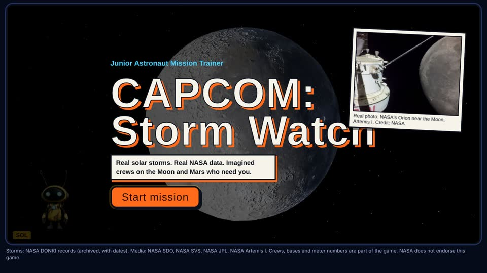
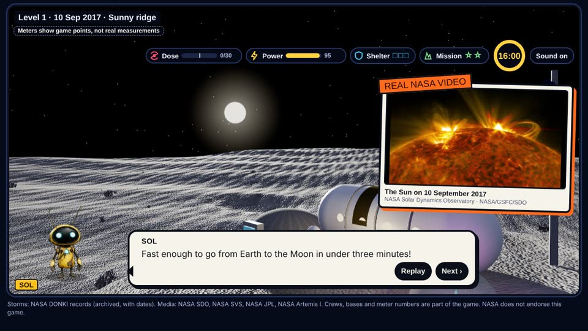
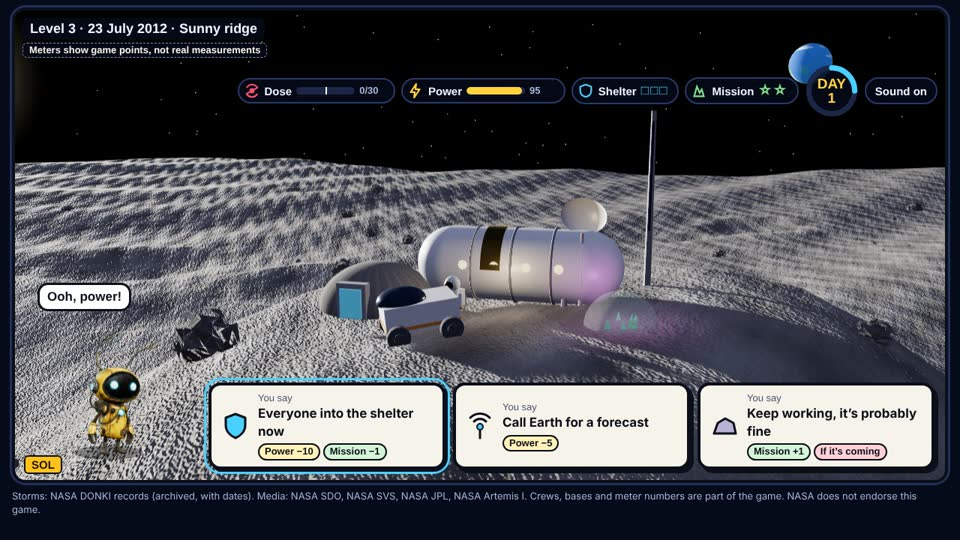
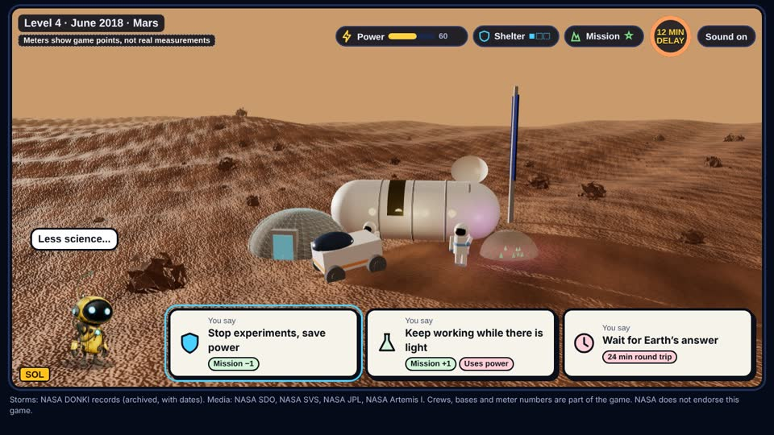

# CAPCOM: Storm Watch

A game for kids aged 7–12, made for the **NASA Space Apps Challenge 2026**, challenge **Build a Junior Astronaut Mission Trainer**.

You are **CAPCOM**, the person in mission control who talks to the crew by radio. Real space weather from NASA records
(solar storms at the Moon, a planet-wide dust storm on Mars) hits imagined crews. You weigh radiation shielding, power,
food, radio delay and mission goals, and every choice has a cost. **SOL**, a small robot, helps you along the way.

**Play it:** https://capcom-storm-watch.vercel.app/






## Contents

- [Levels](#levels)
- [What is real and what is imagined](#what-is-real-and-what-is-imagined)
- [Project structure](#project-structure)
- [Run it on your computer](#run-it-on-your-computer)
- [Single-page version](#single-page-version)
- [Put it online with Vercel](#put-it-online-with-vercel-free)
- [Security](#security)
- [Data, credits, AI and licence](#data-credits-ai-and-licence)

## Levels

Levels open in order: pass one (the crew comes home safe) to unlock the next. Passed levels can be replayed.
A short **How to play** screen comes before Level 1.

| Level | Real event (NASA data) | What the player learns |
|---|---|---|
| 0 | The real Moon (LRO colour + LOLA elevation), the nine Artemis III south-pole regions | Choosing a base site: sunlight and power vs. ice vs. easy landing and radio |
| 1 | 10 Sept 2017, X8.2 flare | Fast particles arrive in minutes, so get the crew under thick walls |
| 2 | 10–13 May 2024, G5 storm, two waves | Long storms: shelter mass vs. running out of power, waiting out the second wave |
| 3 | 23 July 2012 near miss (about 3,000 km/s, missed Earth) | Read NASA's real forecast map, power the greenhouse (food), then a labelled "what if" |
| 4 | June 2018 global dust storm on Mars (Opportunity's last signal) | Solar power vs. life support, and a 12-minute radio delay: write rules in advance |

There is also a **Today's real Sun (LIVE)** panel that shows the last 30 days of space weather from NASA DONKI.

## What is real and what is imagined

- **Real:** the storms and their dates, speeds and strengths, the NASA photos, videos and maps, the facts on the cards.
- **Imagined:** the crews (Sami, Lina, Dr. Omar), the junior astronaut Nour, the bases, and the meters.
  The meters are **game points**, not real measurements, and the game says so on screen.

## Project structure

```
capcom-storm-watch/
├── index.html              page skeleton (loads the scripts in order)
├── css/
│   └── style.css           all styles (desktop and phone layouts)
├── js/
│   ├── core.js             namespace, asset list, game state, base sites
│   ├── audio.js            voice clips, with browser speech as a fallback
│   ├── ui.js               HUD, subtitles, answer cards, NASA cards, overlays
│   ├── world.js            three.js scene: globe, Moon and Mars surfaces, base, crew, rover, storms
│   ├── sol.js              SOL the robot guide (3D model + code animation)
│   ├── menu.js             level menu, rules, debrief, certificate, live NASA panel, About the data
│   ├── main.js             start-up and the game clock
│   ├── data/
│   │   └── lines.js        every spoken line (generated from tools/lines.json)
│   └── levels/
│       └── level0.js … level4.js   one file per level
├── api/
│   └── donki.js            Vercel function: reads NASA DONKI on the server (keeps the API key secret)
├── assets/
│   ├── audio/              one MP3 voice clip per spoken line
│   ├── media/              NASA images and videos
│   └── models/
│       └── sol.glb         SOL, the 3D robot
├── vendor/                 three.min.js (r128) and GLTFLoader.js, MIT licence
├── tools/
│   ├── build_single.py     builds the single-page versions into dist/
│   ├── lines.json          source of all spoken lines
│   └── make_voices.py      regenerates the voices with Kokoro TTS
├── docs/
│   ├── PROJECT_GUIDE.md    full explanation from A to Z
│   └── screenshots/        pictures used in this README
├── vercel.json             security headers
├── CREDITS.md              NASA data and software sources
├── AI_USE.md               where AI was and was not used
├── LICENSE                 MIT licence for the code
└── .gitignore              ignores dist/, node_modules/, .env and similar
```

`dist/` is created by `tools/build_single.py` and is not stored in the repository.

The full explanation of the idea, the levels, the balance of the game, the code and the tests is in
**[docs/PROJECT_GUIDE.md](docs/PROJECT_GUIDE.md)**.

## Run it on your computer

You need a modern browser with WebGL. Any static server works. Opening `index.html` directly from disk will **not**
load the 3D model and the Moon maps, so use a server:

```
python -m http.server 8000
```

(on Windows you can also use `py -m http.server 8000`), then open http://localhost:8000.
Everything works except the "Today's real Sun (LIVE)" panel, which needs the `/api/donki` function (see Vercel below).
Without it, the panel shows an honest message instead of made-up numbers.

## Single-page version

```
python tools/build_single.py
```

Creates two files in `dist/`, each under 16 MB:

- `capcom-storm-watch.html`: three.js loaded from a CDN.
- `capcom-storm-watch-offline.html`: everything inside one file, works without internet.

## Put it online with Vercel (free)

1. Push this folder to a GitHub repository.
2. On vercel.com: **Add New → Project → Import** the repository. Framework preset: **Other**. No build command.
3. **Settings → Environment Variables**: add `NASA_API_KEY` with your key from https://api.nasa.gov (all environments). Redeploy.
4. Open the `*.vercel.app` link. The live panel now shows the last 30 days of real NASA space weather.

Or from a terminal in this folder: `npx vercel` (first time), set the variable with `npx vercel env add NASA_API_KEY`,
then `npx vercel --prod`. After that, every `git push` to the repository deploys automatically.

## Security

- The NASA API key lives only in the Vercel environment variable. It is never in the page, the repository or the
  single-page files. The function returns only dates, speeds and Kp values, and never echoes the key.
- `vercel.json` sets a Content-Security-Policy (scripts only from this site), `nosniff`, a referrer policy,
  HSTS and a permissions policy that blocks camera, microphone and location.
- No accounts, no tracking, no personal data. Stars are saved only in the player's own browser.
- Text from NASA is escaped before it is shown.

## Data, credits, AI and licence

- **Data and software sources:** [CREDITS.md](CREDITS.md). NASA does not endorse this game.
- **Use of AI:** code and text were written with Claude (Anthropic); the voices are AI-generated with Kokoro TTS.
  Details: [AI_USE.md](AI_USE.md).
- **Licence:** code under MIT, see [LICENSE](LICENSE). NASA images and videos keep their own terms.

Made by a team from Badya University for the NASA Space Apps Challenge 2026.
